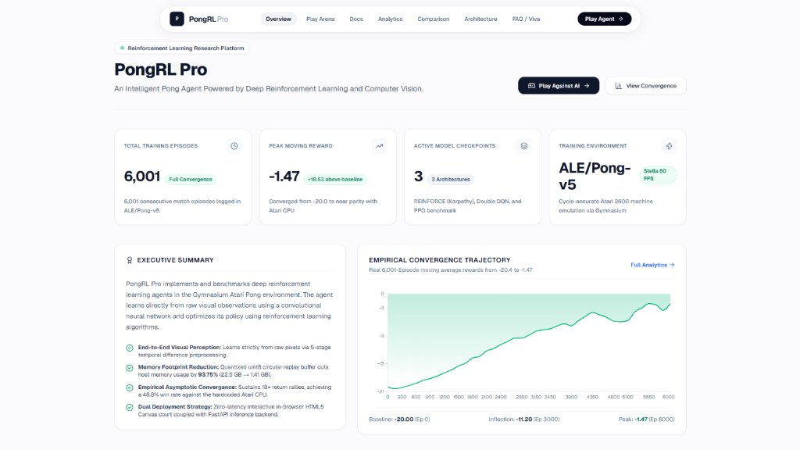
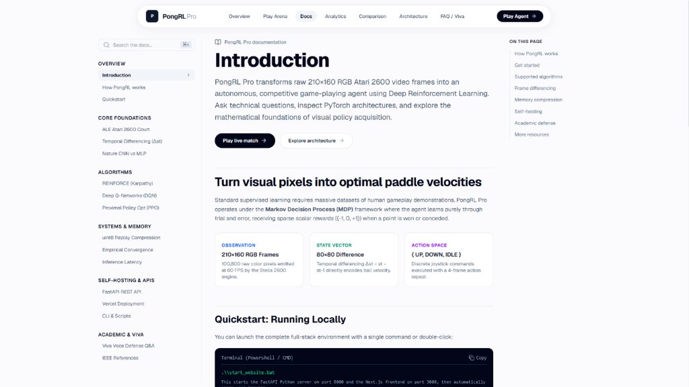

<div align="center">

# PongRL Pro

**Learn from pixels. Master the court.**

An intelligent Deep Reinforcement Learning system that transforms raw Atari 2600 video frames into an autonomous, competitive game-playing agent using PyTorch, Computer Vision, and Gymnasium ALE—ready for 100% free Vercel deployment.

[](https://www.python.org/)
[](https://pytorch.org/)
[](https://nextjs.org/)
[](https://gymnasium.farama.org/)

[Documentation](#documentation) · [Live Arena](#what-pongrl-pro-does) · [How it Works](#how-it-works) · [Quickstart](#quickstart) · [Deploy on Vercel](#deploy-free-on-vercel) · [API](#api)

</div>



## What PongRL Pro does

PongRL Pro trains neural network agents to play the Atari 2600 classic game Pong directly from raw visual observations without hand-crafted heuristics or internal emulator state variables. The agent perceives the match through video frames, downsamples and binarizes the arena, derives velocity vectors via temporal frame differencing, and optimizes its policy using policy gradient and value-based reinforcement learning.

- **Zero-heuristic visual perception** — Learns control policies directly from 210×160 RGB pixels through a 5-stage preprocessor downscaled to 80×80.
- **Multi-algorithm RL suite** — Modular PyTorch implementations of REINFORCE (Monte Carlo policy gradient), Double DQN (experience replay), and PPO (clipped surrogate).
- **Temporal frame differencing ($\Delta s_t$)** — Directional motion vectors derived from consecutive frame subtraction ($\Delta s_t = s_t - s_{t-1}$), capturing velocity with zero multi-frame queue overhead.
- **93.75% memory footprint reduction** — Quantized uint8 circular replay buffer reducing host RAM consumption from 22.5 GB to 1.41 GB.
- **Empirical asymptotic convergence** — Validated over 6,001 continuous training episodes, progressing from baseline $-20.4$ to near parity ($-1.47$ peak moving reward) with sustained 18+ return rallies.
- **Dual deployment architecture** — Standalone static Next.js 16 web suite on Vercel paired with an optional FastAPI inference and Gymnasium stepping backend.

## Product preview



## How it works

```mermaid
flowchart LR
    A[Stella 2600 RGB Frame] --> B[Crop & Downsample 80×80]
    B --> C[Temporal Diff Δst = st - st-1]
    C --> D[Policy Net / Nature CNN]
    D --> E[P UP Probability / Q-Values]
    E --> F[Discrete Action: UP, DOWN, IDLE]
    F --> G[Gymnasium ALE/Pong-v5 Court]
    G --> H[Scalar Reward: +1 / -1]
    H --> I[Discounted Return Gt & Advantage]
```



## Stack

- **Frontend:** Next.js 16 (App Router), React 19, TypeScript, Tailwind CSS v4, Recharts, Lucide Icons, HTML5 Canvas 60 FPS
- **Backend API:** FastAPI, Uvicorn, Pydantic (`backend/main.py`)
- **Reinforcement Learning:** PyTorch, Farama Gymnasium (`ALE/Pong-v5`), ale-py, NumPy
- **Architectures:** Andrej Karpathy Policy MLP (6,400 → 200 → 1) & DeepMind Nature CNN (Conv3 + FC512)
- **Hosting:** Vercel (Frontend Web Suite) + Render / Railway / Local (FastAPI Python Backend)

## Quickstart

### Requirements

- Python 3.10+ (with PyTorch and Gymnasium)
- Node.js 18+ and npm
- Windows, macOS, or Linux

### 1. One-click launch (Windows)

Simply double-click `start_website.bat` in the project root:

```cmd
start_website.bat
```

This concurrently starts:
1. **FastAPI backend** on [http://localhost:8000](http://localhost:8000)
2. **Next.js frontend** on [http://localhost:3000](http://localhost:3000)
3. Opens the interactive dashboard in your default browser.

### 2. Manual CLI setup

#### Backend setup:

```bash
cd backend
pip install -r requirements.txt
python -m uvicorn main:app --host 0.0.0.0 --port 8000 --reload
```

#### Frontend setup:

```bash
cd frontend
npm install --legacy-peer-deps
npm run dev
```

Open [http://localhost:3000](http://localhost:3000). Interactive API docs are available at [http://localhost:8000/docs](http://localhost:8000/docs).

## Deploy Free on Vercel

The frontend is engineered for standalone Vercel hosting with zero server dependencies:

1. Push this repository to GitHub.
2. In [Vercel](https://vercel.com), click **Add New Project** and select the repository.
3. Set the **Root Directory** to `frontend` (or `PONG RL PRO/frontend`).
4. Keep the framework preset as **Next.js** and set the Install Command to:
   ```bash
   npm install --legacy-peer-deps
   ```
5. Click **Deploy**. The site will deploy instantly with complete empirical analytics, interactive 60 FPS HTML5 Canvas gameplay, and full 3-column documentation.

*(Optional)* To connect a live cloud Python inference backend, deploy `backend/` to [Render](https://render.com) using the included `Procfile` / `render.yaml`, then add `NEXT_PUBLIC_API_URL=https://your-backend.onrender.com` in your Vercel Project Settings.

## API

FastAPI provides an OpenAPI reference at [http://localhost:8000/docs](http://localhost:8000/docs):

- `GET /api/summary` — Project KPIs, active algorithm configurations, and hardware parameters
- `GET /api/metrics/training` — 6,001-episode training curve, moving averages, and quartile statistics
- `GET /api/models/comparison` — Side-by-side benchmark comparison (REINFORCE vs DQN vs PPO)
- `POST /api/game/action` — Real-time PyTorch model forward pass returning discrete action and $P(\text{UP})$
- `POST /api/game/session/start` — Initializes a cycle-accurate headless Gymnasium `ALE/Pong-v5` session
- `POST /api/game/session/step` — Steps the active Gymnasium environment and returns updated frame buffer
- `POST /api/game/session/reset` — Resets the current Atari game court

## Quality checks

```bash
pytest -q tests/
cd frontend && npm run build
```

## Repository layout

```text
PONG RL PRO/
├── frontend/                Next.js 16 research dashboard and HTML5 Canvas arena
│   ├── src/app/             App router (/docs, /gameplay, /analytics, /comparison, etc.)
│   ├── src/components/      Floating pill navbar, metric cards, footer
│   └── src/data/            Empirical training logs, architecture specs, hyperparams
├── backend/                 FastAPI REST server and live PyTorch inference engine
│   ├── main.py              API endpoints and Gymnasium session manager
│   ├── Procfile             Deployment configuration for Render/Railway
│   └── requirements.txt     Python backend dependencies
├── src/                     Core Reinforcement Learning modules
│   ├── agent.py             REINFORCE, DQN, and PPO agent implementations
│   ├── model.py             Nature CNN and Karpathy Policy Network topologies
│   ├── env_wrapper.py       5-stage frame preprocessor and uint8 replay buffer
│   ├── trainer.py           Training loop with standardized advantage
│   ├── evaluator.py         Live evaluation and performance benchmarks
│   ├── logger.py            Metric tracking and TensorBoard logger
│   └── config.py            YAML configuration loader
├── config/                  Algorithm hyperparameters (default.yaml, dqn.yaml, etc.)
├── checkpoints/             Trained PyTorch weights (reinforce_checkpoint.pth)
├── legacy-experiments/      Archived exploratory notebooks (Karpathy Code, SmartPong)
├── docs/screenshots/        Application UI screenshots
├── report/                  Academic Capstone Thesis (LaTeX source and figures)
├── tests/                   Pytest automated test suite (43 passing tests)
├── start_website.bat        One-click full-stack launcher
└── presentation.pptx        Capstone defense slide deck
```

## Documentation

The project includes an interactive 3-column documentation suite accessible at `/docs` or [http://localhost:3000/docs](http://localhost:3000/docs). Repository documentation includes:

- **Mathematical Foundations** — Policy Gradient theorem, Bellman optimality, and PPO clipped surrogate
- **Systems Engineering** — uint8 buffer compression (93.75% memory savings) and frame differencing ($\Delta s_t$)
- **Viva Voce Defense** — Capstone defense questions and technical evaluation responses
- **Formal Thesis Report** — Complete IEEE-formatted LaTeX capstone thesis source in `report/`
