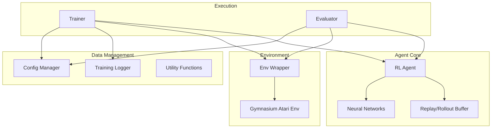
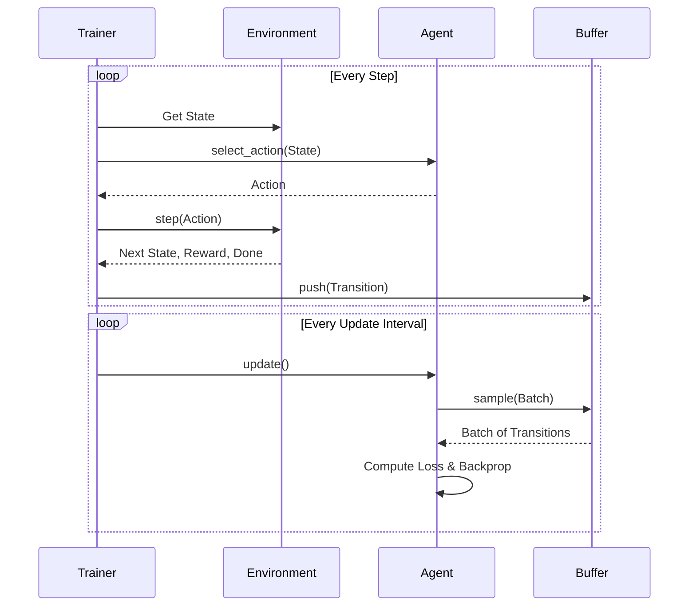

# System Architecture

## Overview
The PongRL Pro framework is designed using strict object-oriented principles and separation of concerns. This modular design ensures that different components—such as neural network models, reinforcement learning algorithms, environment processing, and training loops—can be developed, tested, and modified independently.

## Architecture Diagram

## Component Descriptions

1. **Config Manager (`src/config.py`)**: Loads YAML configuration files, merges default settings with user overrides, and provides a centralized, typed data structure accessible by all modules.

2. **Environment Wrapper (`src/env_wrapper.py`)**: Responsible for instantiating the raw Gymnasium environment and chaining a series of preprocessing wrappers. This handles the conversion of raw RGB pixels into stacked, grayscaled tensors suitable for CNN input.

3. **Models (`src/model.py`)**: Contains PyTorch implementations of neural network architectures. These are pure functions that map state tensors to action probabilities or Q-values.

4. **Agents (`src/agent.py`)**: The algorithmic core. Agents utilize models to make decisions (`select_action`) and utilize memory buffers to learn from past experiences (`update`).

5. **Memory Buffers (`src/replay.py`)**: Data structures optimized for storing and retrieving environment transitions. 

6. **Trainer/Evaluator (`src/trainer.py`, `src/evaluator.py`)**: High-level orchestrators that run the control loops. 

## Data Flow Diagram

## Design Patterns

- **Strategy Pattern**: The `Trainer` depends on the `BaseAgent` interface. Different RL algorithms (DQN, PPO) implement the specific logic, allowing the trainer to switch algorithms dynamically without code changes.
- **Factory Pattern**: `make_pong_env` acts as a factory, abstracting the complex instantiation and wrapping process of the Gymnasium environment.
- **Observer Pattern**: The `TrainingLogger` acts as an observer, receiving metric updates from the Trainer and Agent to persist and plot.

## Technology Stack Justification

| Technology | Purpose | Justification |
|------------|---------|---------------|
| **Python 3.10+** | Base Language | Industry standard for ML/AI. |
| **PyTorch** | Deep Learning | Highly flexible, dynamic computation graphs. |
| **Gymnasium** | RL Environments | The maintained successor to OpenAI Gym. |
| **PyYAML** | Configuration | Human-readable configuration management. |
| **Streamlit** | Dashboarding | Rapid development of interactive data applications. |
| **TensorBoard** | Metric Tracking | Standard tool for visualizing deep learning metrics. |
